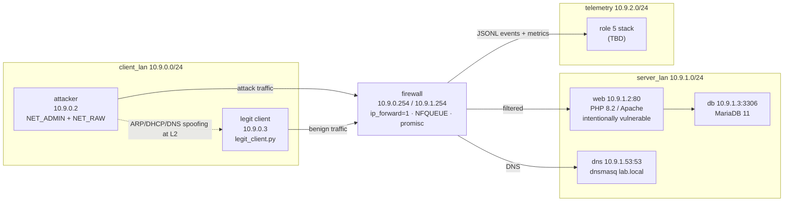

# Role 1 - Infrastructure Architect

**Scope:** lab topology, protected targets, legitimate traffic, reproducibility.
**Status:** scaffold landed (see §7). M0 runtime validation is the next action.
**Owner:** role 1. **Consumers:** roles 2-5.
**Source of truth for requirements:** [`../tp4.md`](../tp4.md) (converted from the assignment PDF).

> **`main` implements task 1 only:** the topology with the firewall as
> mandatory gateway, the web+db targets and the benign traffic generator. The
> extra zones and components referenced in §3.4-§6 and §7 (in-lab DNS,
> telemetry network, firewall engine, attack scripts, monitoring stack) are on
> `full-work`; the plan keeps them because they shape this design.

---

## 1. What role 1 must make true

Without this, nobody can test anything. Four hard requirements, all traceable to
the assignment:

| Ref | Requirement | Where it lands |
| --- | --- | --- |
| §3/§4 | Attacker, legitimate client, firewall and protected service exist, and the firewall is the **mandatory path** | `lab/docker-compose.yml`, `lab/scripts/verify-path.sh` |
| §3 | Protected service = HTTP server + SQL database | `lab/web/`, `lab/db/` |
| §3 "Legitimate service" | Benign traffic keeps succeeding *before, during and after* every attack, with measurements | `lab/traffic/legit_client.py`, trial protocol (§8) |
| §8 | One-command reproduction + README | `lab/Makefile`, `lab/README.md` |

Non-goals: firewall decision logic (role 2), detectors (roles 3/4), dashboards
(role 5).

---

## 2. Locked decisions

| # | Decision | Rationale |
| --- | --- | --- |
| D1 | Docker Compose, multi-arch images, runs on macOS arm64 and Linux x86_64/arm64 | Team machines differ; assignment explicitly allows a container-based lab |
| D2 | Two data-plane zones: `client_lan 10.9.0.0/24`, `server_lan 10.9.1.0/24`, plain bridges with an explicit default route to the firewall and the Docker bridge gateway blackholed | Firewall is the only route. `internal: true` is *not* usable: Docker 28+ drops routed frames leaving the bridge subnet (see R2) |
| D3 | Attacker **and** legitimate client share `client_lan` with the firewall's LAN interface | Makes ARP/DHCP/DNS spoofing really observable by the firewall, instead of hand-waved as out of scope |
| D4 | Monitoring stack deferred to role 5; role 1 guarantees a file sink, a push hook (`LAB_TELEMETRY_SINK`) and an isolated `telemetry` network | Avoids blocking on a 4-8 GB ELK decision |
| D5 | Firewall container fails **closed** (`FORWARD` DROP) when the engine is missing | Nobody can mistake an unimplemented firewall for a working one |
| D6 | No data-plane port is published to the host | §9: no convenience bypass, no exposure |
| D7 | UTC everywhere, millisecond precision, shared trial IDs | §5.1.5 correlation requirement |

### Still open (decide with the team, does not block M0)

| # | Question | Default if nobody answers |
| --- | --- | --- |
| O1 | MariaDB 11 acceptable as "MySQL" target? (assignment says MySQL/PostgreSQL) | keep MariaDB; it is MySQL-protocol compatible and multi-arch |
| O2 | Monitoring stack (ELK vs Grafana/Loki) | role 5 decides, `LAB_TELEMETRY_SINK` already wired |
| O3 | Firewall language: Python+NFQUEUE or C | base image has Python+Scapy; C needs `gcc/make/libnetfilter_queue-dev` added (5-line Dockerfile change) |
| O4 | Does role 4 want a `wan` zone + reflector container for UDP amplification? | not built; override snippet in §6.3 |
| O5 | Keep `dns` always on, or behind a profile? | always on: it is cheap and DNS spoofing needs it |

---

## 3. Architecture

### 3.1 Topology



Plain-text version, for the report diagram (§4.1 requires an original one):

```text
[attacker 10.9.0.2]  [client 10.9.0.3]
        \                 /
         \  client_lan   /        (same L2 segment: ARP/DHCP visible to firewall)
          \             /
        [firewall 10.9.0.254 | 10.9.1.254 | 10.9.2.254]
          /             \
   server_lan             telemetry
        |                     |
 [web 10.9.1.2] --- [db 10.9.1.3]   [monitoring 10.9.2.x]
 [dns 10.9.1.53]
```

### 3.2 Addresses and interfaces

| Host | client_lan | server_lan | telemetry | Pinned MAC |
| --- | --- | --- | --- | --- |
| attacker | 10.9.0.2 | - | - | `02:42:0a:09:00:02` |
| client | 10.9.0.3 | - | - | `02:42:0a:09:00:03` |
| firewall | 10.9.0.254 | 10.9.1.254 | 10.9.2.254 | docker-assigned |
| web | - | 10.9.1.2 | - | docker-assigned |
| db | - | 10.9.1.3 | - | docker-assigned |
| dns | - | 10.9.1.53 | - | docker-assigned |
| monitoring | - | - | 10.9.2.2 (reserved) | - |

Interface names inside the firewall are **resolved from the IP at start**
(`iface_for_ip` in `scripts/lib.sh`), never assumed to be `eth0/eth1/eth2`:
Docker does not guarantee attachment order.

Every container that must use the firewall as its gateway needs `NET_ADMIN` to
install that route and blackhole the bridge gateway. This is why
`client`, `web` and `dns` carry the capability too, and why the report must
explain it under §9 ("limit elevated capabilities to the components that require
them"): the capability programs one route at boot and is never used again.

### 3.3 Packet path (what the report has to describe)

1. `client` wants `10.9.1.2`. Its only default route is `10.9.0.254`
   (`scripts/net-init.sh`: rewrite the default route, blackhole `10.9.x.1`).
2. The frame is delivered to the firewall's `client_lan` interface. Docker does
   **no** routing for it: the firewall container owns both subnets, so the
   decision happens inside its network namespace.
3. Role 2's `main.py` receives the packet (NFQUEUE on `mangle/PREROUTING` or
   `filter/FORWARD`) and returns ACCEPT / DROP / REJECT / rate-limited.
4. On ACCEPT the kernel forwards it out of `server_lan` to the web container.
   The reply follows the mirror path, because every host's default route points
   at the firewall.
5. Enforcement point = the firewall netns. There is no other path: neither
   network has an external gateway.

### 3.4 Telemetry path

```text
firewall main.py --append--> /var/log/firewall/events.jsonl  (host: lab/logs/firewall/)
                              |
                              +-- optional push --> $LAB_TELEMETRY_SINK --> role 5 stack (10.9.2.0/24)

client legit_client.py --> /var/log/client/legit.jsonl + legit-summary-<trial>.json
web / db --> container health + HTTP availability measured by the client
```

Event contract: `lab/config/event.schema.json` (JSON Schema, mirrors §6.2:
time, attack, traffic, decision, reason, counters, outcome).

### 3.5 The four things that bypass the firewall (must be stated in the report)

1. **L2 traffic inside `client_lan`** — attacker ↔ client frames are switched,
   not routed. This is deliberate: it is the only way ARP/DHCP spoofing is real.
   The firewall sees it in promiscuous mode on its LAN interface.
2. **Container management plane** — `docker exec`, image pulls, the Docker
   socket. Out of scope, no service depends on it during a trial.
3. **Role 5 UI port** — published to the host for the demo, on the telemetry
   network only, never load-bearing for the attack path.
4. **Web ↔ db** — same subnet, same zone, by design (the DB is not exposed to
   `client_lan`; SQLi reaches it through the app, not the network).

---

## 4. Deliverables and acceptance criteria

| # | Deliverable | State | Done when |
| --- | --- | --- | --- |
| D1 | `lab/docker-compose.yml` + `lab/.env` | scaffold | `docker compose config` valid; `make up` reaches all healthy |
| D2 | Multi-arch base + web images | scaffold | builds on arm64 and x86_64 with no arch-specific hack |
| D3 | Firewall container contract (caps, sysctls, ifaces, log dir, fail-closed) | scaffold | engine can run as non-privileged-as-possible root with `NET_ADMIN`+`NET_RAW` only |
| D4 | Targets: web app + MariaDB schema | scaffold | `curl http://10.9.1.2/healthz.php` = `ok`; SQLi sinks reachable |
| D5 | Benign traffic generator + trial protocol | scaffold | 10-min run with ≥99% availability on an idle lab; JSONL + summary written |
| D6 | `verify-path` (packets seen at the firewall vs served) | scaffold | `make verify` proves the firewall is on the packet path |
| D7 | Topology diagram (source + exported PNG/SVG) | **TODO** | matches the deployed IPs/interfaces, includes telemetry + bypass list |
| D8 | `lab/README.md` one-command reproduction | draft | a teammate reproduces from a clean clone in <5 min |
| D9 | Baseline evidence pack for the checkpoint | **TODO** | logs + availability graph, 10-min window, exported and referenced |
| D10 | Contracts for roles 2-5 | done | each role can start without asking role 1 |

---

## 5. Interfaces handed to the other roles

| Consumer | Gets | Must not do |
| --- | --- | --- |
| role 2 (engine) | container with `NET_ADMIN`+`NET_RAW`, `ip_forward=1`, `rp_filter=0`, `$LAB_IF_CLIENT/$LAB_IF_SERVER/$LAB_IF_TELEMETRY`, `/opt/config/firewall.yaml`, `/var/log/firewall` | publish ports, disable forwarding, edit compose without telling role 1 |
| role 3/4 (attacks) | `attacker` container with scapy/nmap/hping3/tcpdump, `attacks/` mounted at `/opt/attacks`, env with all victim IPs, MACs pinned | send traffic outside `10.9.0.0/24`/`10.9.1.0/24`; hard-code IPs inside scripts |
| role 4 (L2/L7) | shared L2 segment with the client, firewall in promisc, in-lab DNS behind the firewall, pinned MACs | assume DHCP is in use (see R4) |
| role 5 (telemetry) | `events.jsonl` + schema, `legit.jsonl`, `telemetry` network, `LAB_TELEMETRY_SINK`, reserved `10.9.2.2` | scrape/route on the data-plane networks |
| everyone | `make trial TRIAL=<id>` to stamp a window, `make verify`, `make logs F=<svc>` | run attacks without a matching trial ID |

Trial protocol (the part role 5 needs):

```bash
make trial TRIAL=t-001-baseline DURATION=120   # benign only
make attack A=20-syn-flood.sh                  # during or after the baseline
```

Every artefact of a trial carries the same `trial` value: firewall events, client
JSONL, attacker logs, dashboard annotation.

---

## 6. Open technical gaps and how they close

### 6.1 NFQUEUE availability on Docker Desktop (blocking, M0)

Docker Desktop runs a LinuxKit kernel. `iptables -j NFQUEUE` may be absent, in
which case the whole design needs a different runtime. The probe on `main`
(`scripts/doctor.sh`, task 2) inserts a real NFQUEUE rule, sends one packet and
checks that the packet is held.

- **Pass** → continue on Docker Desktop.
- **Fail** → same compose files on an Ubuntu arm64 VM in UTM (native kernel
  modules, no Docker Desktop). Only `docker context`/host changes; no file
  changes. Documented fallback, not a rewrite.

### 6.2 DHCP spoofing needs a DHCP client

Containers are statically addressed, so nobody asks for a lease. Role 4 must run
a DHCP client inside the `client` container for that demo (`dhclient -1 -v eth0`,
package `isc-dhcp-client`, currently not installed). Alternative: capture the
attacker's DHCP OFFER at the firewall and demonstrate detection without a real
lease. Decision needed from role 4, doesn't change the topology.

### 6.3 UDP amplification needs a reflector (optional `wan` zone)

Not built. If role 4 wants real reflection, add a fourth leg:

```yaml
# docker-compose.override.yml (not committed in the default path)
networks:
  wan:
    driver: bridge            # not internal, same reason as the two zones
    ipam: { config: [{ subnet: 10.9.3.0/24 }] }
services:
  firewall:
    networks:
      wan: { ipv4_address: 10.9.3.254 }
  reflector:                     # pretends to be a public NTP/CHARGEN/DNS
    <<: *lab-base
    entrypoint: ["/opt/lab/net-init.sh"]
    command: ["python3", "-u", "/opt/attacks/reflector.py"]
    networks:
      wan: { ipv4_address: 10.9.3.53 }
    environment:
      GATEWAY: 10.9.3.254
```

Amplified replies then hit the firewall inbound, which is exactly the traffic
the detector must see. Cost: one more zone in the diagram.

### 6.4 Docker's embedded DNS

The client's resolver is set with `dns: [10.9.1.53]`, but Docker may still front
it with `127.0.0.11`. Mitigation if that hides queries from the firewall: bind
`/etc/resolv.conf` directly or disable the embedded resolver and keep a static
`resolv.conf` in the client image. Verify in M2 with
`docker compose exec client dig www.lab.local` **and** a capture on the firewall.

### 6.5 Known macOS quirks

- Bind mounts are slower and do not support inotify reliably: no live-reload
  expectations in the web app.
- File modes are preserved, so the `chmod +x` on `scripts/` matters and is done.
- Docker Desktop VM memory: 4 GB is enough for the lab, 8 GB if role 5 picks ELK.

---

## 7. What exists now (scaffold)

```text
lab/
├── docker-compose.yml      2 zones, 5 services
├── .env                    addresses, MACs, database credentials
├── Makefile                up/down/verify/baseline/trial/logs
├── images/base/Dockerfile  debian:12-slim + python3 (attacker, client, firewall)
├── images/web/Dockerfile   php:8.2-apache + mysqli
├── web/{index,product,healthz,db}.php   vulnerable target (SQLi sinks)
├── db/init.sql             users/products seed
├── traffic/legit_client.py benign generator (HTTP + ICMP, JSONL + summary)
├── scripts/{lib,net-init,verify-path}.sh
├── README.md               quick start, addressing, troubleshooting
└── logs/                   runtime only (gitignored)
```

Validation already done: `docker compose config` valid; all shell scripts pass
`bash -n`; `legit_client.py` compiles. Not yet run: anything requiring the
Docker daemon (stopped at the time of writing).

---

## 8. Plan: milestones

Today: **15 Nov 2026**. Checkpoint: **10 Dec 2026, 14-16h**. Submission:
**10 Jan 2027**.

### M0 - Runtime gate (16-17 Nov)

- [ ] Start Docker Desktop, `make build`.
- [ ] `make up` on the target runtime; `make verify` green (no NFQUEUE
      dependency in task 1 — the interception gate is task 2's M0).
- [ ] Decide runtime: Docker Desktop **or** UTM Linux VM (fallback).
- [ ] Record the decision + evidence in `docs/plan/01-infra.md` (append a short log).
- **Exit:** interception primitive proven on the real runtime.

### M1 - Topology and path (18-22 Nov)

- [ ] `make up` → all healthy; `docker compose ps` clean.
- [ ] `make verify` → packets seen at the firewall, served by the web app.
- [ ] Confirm no default route points anywhere but the firewall in all 5 containers.
- [ ] Confirm `rp_filter=0`, `ip_forward=1` inside the firewall.
- **Exit:** the firewall is provably the only path.

### M2 - Targets (23-27 Nov)

- [ ] Web app serves `index.php`, `product.php`, `healthz.php`; DB seeded.
- [ ] SQLi sinks reachable (`?id=1'`, `?q='`) — role 4's target.
- [ ] `dns` resolves `www.lab.local` from the client, query visible at the firewall.
- [ ] Healthchecks stable for 30 min (`docker compose ps` no restarts).
- **Exit:** the attack surface exists and is stable.

### M3 - Legitimate traffic (28 Nov - 2 Dec)

- [ ] `make trial TRIAL=t-000-baseline DURATION=600` on an idle lab.
- [ ] Availability ≥ 99 %, p95 latency recorded, summary JSON produced.
- [ ] Verify the JSONL parses against `event.schema.json`-compatible tooling.
- [ ] Document the measurement method (what "benign" means, why `/healthz.php`).
- **Exit:** a reproducible benign baseline exists *before* any attack.

### M4 - Checkpoint (3-9 Dec)

- [ ] Role 2 engine runs with the real policy (no temporary ACCEPT policy).
- [ ] One attack from role 3 and one from role 4 run end-to-end with `trial` IDs.
- [ ] Topology diagram exported (D7) with addresses, interfaces, telemetry path,
      bypass list.
- [ ] `lab/README.md` reproduces the lab from a clean clone.
- [ ] Baseline evidence pack (D9) + 10-minute checkpoint deck.
- **Exit:** the checkpoint demo only uses documented commands.

### M5 - Hardening and final package (11 Dec - 5 Jan)

- [ ] Re-run every trial on a clean `make reset` (reproducibility).
- [ ] Fill the "bypasses the firewall" and "failure behaviour" sections with real
      observations (firewall killed, log sink down).
- [ ] Final README with the exact command per attack test.
- **Exit:** a teammate can rebuild and re-run every trial without role 1 present.

### M6 - Submission (6-10 Jan)

- [ ] `make reset && make up && make verify` one last time.
- [ ] Zip `NS-TP4-PL1x.zip` (report + code, no `logs/`, no volumes).
- [ ] AI-use declaration lists the actual tools/prompts used during the work.
- **Exit:** upload done before 10 Jan 2027 23:59.

---

## 9. Risk register

| # | Risk | Impact | Mitigation / gate |
| --- | --- | --- | --- |
| R1 | NFQUEUE missing in Docker Desktop kernel | Blocks interception (task 2) | doctor probe on `main`; fallback UTM Ubuntu arm64 VM, same compose files |
| R2 | Docker 28+ enforces `internal: true` with `DOCKER-INTERNAL` drops on cross-subnet frames, which breaks a router topology | Cross-zone traffic dies silently (observed: 26 dropped packets) | zones are plain bridges; `net-init.sh` forces the route + blackholes `.1`; `verify-path.sh` asserts packets reach the firewall |
| R3 | Docker bridge does not deliver forged ARP to peers | ARP spoofing demo fails | pinned MACs, promisc on firewall, L2 test at M0/M2; fallback = dedicated Linux bridge on the UTM VM |
| R4 | No DHCP client → DHCP spoofing has no victim | One attack weakens | role 4 decision: install `isc-dhcp-client` in the client image, or "detected only" with the OFFER captured at the firewall |
| R5 | Embedded DNS hides queries from the firewall | DNS spoofing not observable | static `resolv.conf` / disable embedded resolver (6.4) |
| R6 | Container binds are slow on macOS | Developer friction | keep code volumes small; no live-reload assumptions |
| R7 | Image not available for arm64 | Onboarding fails | multi-arch only in `images/`; build on both hosts before merging |
| R8 | Root + `NET_ADMIN` containers | Safety rule §9 | lab-only networks, no published data-plane ports, `make clean` documented |
| R9 | Clock drift between containers/host | Broken correlation | shared host clock, UTC, `date -u` check in each container before a trial |
| R10 | `rp_filter`/`log_martians` reset by the runtime | Spoofed attacks dropped prematurely | entrypoint re-applies sysctls and prints the effective values |
| R11 | Someone "fixes" connectivity by publishing a port or NAT | Bypass invalidates the demo | documented as forbidden in `lab/README.md` + `firewall/README.md` |
| R12 | Trials overwrite each other's evidence | Lost checkpoints | `trial` IDs in every artefact; `logs/` gitignored, exports go to `docs/evidence/` |

---

## 10. Verification checklist (role 1's own tests)

Run in this order; each line is a command, the expected result is the contract.

```bash
make up                     # 5 containers up, web/db healthy
docker compose exec client ip route
                            # default via 10.9.0.254 (never 10.9.0.1)
docker compose exec client ip link
                            # eth0 mac 02:42:0a:09:00:03
make verify                 # exit 0: packets seen at the firewall and served
make trial TRIAL=t-000 DURATION=60
                            # logs/client/legit-summary-t-000.json: availability 100
make reset                  # clean slate, recreate
```

Evidence to keep for the report: the `verify` capture, one `legit-summary`,
`docker compose ps`, and `docker compose exec client ip route`.

---

## 11. Out of scope for role 1

- Any detection threshold, decision rule, or queue/table design (role 2).
- Attack scripts and payloads (roles 3/4).
- Dashboard/log pipeline (role 5).
- Report prose beyond the architecture, topology and reproducibility sections.
